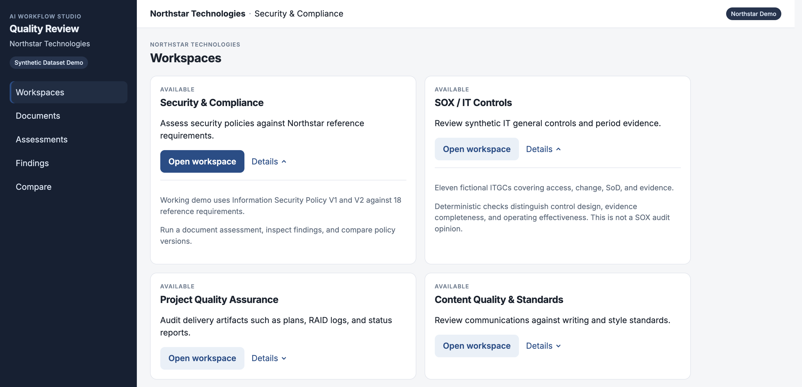
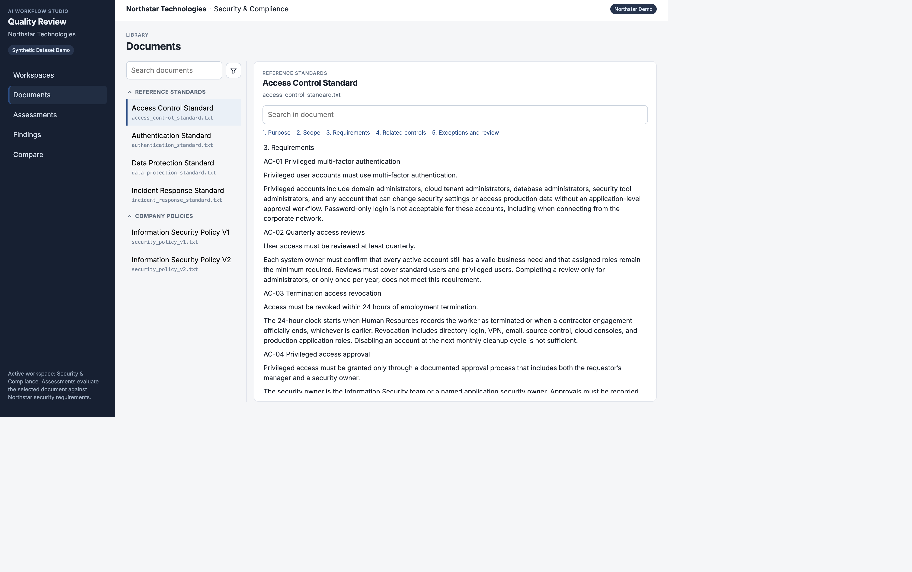
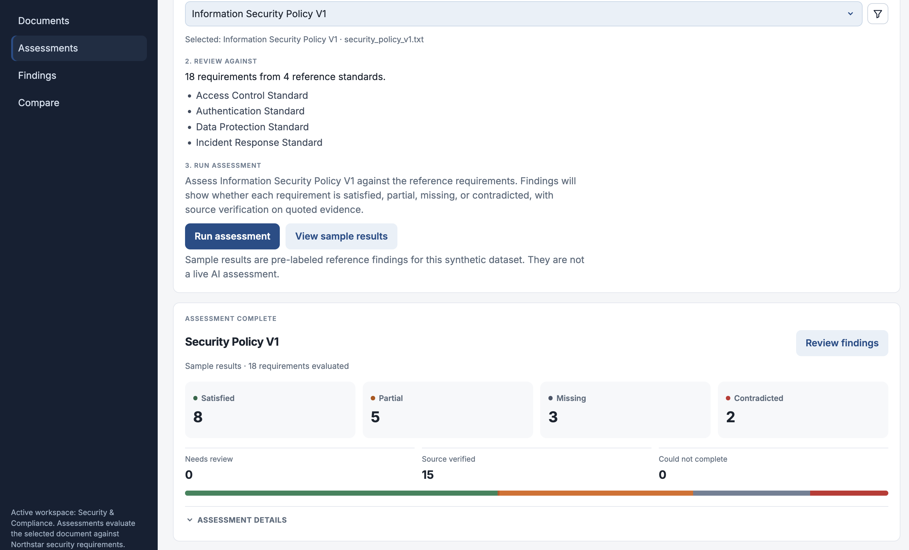
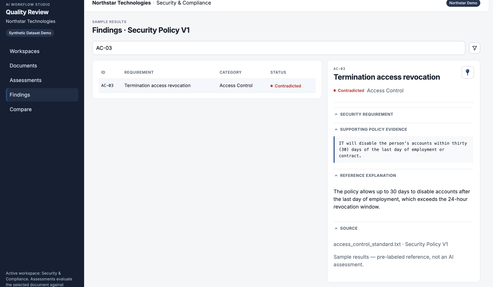
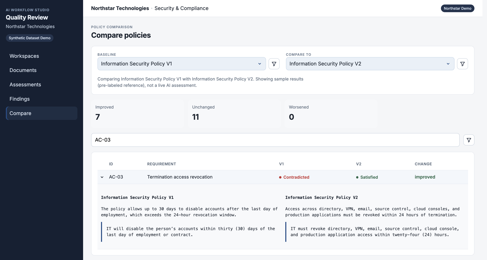

# AI Workflow Studio

An AI-powered quality review platform for assessing organizational documents against defined standards and requirements.

This repository is a working prototype. The demo company is **Northstar Technologies** — fictional — and every policy, control, and evidence file is synthetic. The product is inspired by real IT controls, compliance, and project-quality review work: reviewers still need to read source documents, judge them against a requirement set, and keep findings tied to evidence.

## Product overview

Organizations review policies, control evidence, and delivery artifacts against written standards. That work is slow when quotes are hard to find and when “the model said so” is not enough.

AI Workflow Studio walks a reviewer through a workspace:

1. Choose a workflow (security, ITGC, project QA, or content).
2. Inspect the source library.
3. Run an assessment against the applicable requirements.
4. Inspect findings with quoted evidence and verification status.
5. Compare policy versions where that workflow supports it.

The Security & Compliance workspace can call a language model. Quotes are checked as exact substrings of the original file. Sample (pre-labeled) results exist for the synthetic dataset and are labeled separately from live assessments.

## Product screenshots

Captured from the running React application against the Northstar synthetic dataset. Assessment and comparison screens below use **sample results** (pre-labeled reference findings), not a live paid model run.

### Workspaces

Modular quality-review workspaces. Security & Compliance is the live-AI demo; SOX / IT Controls, Project QA, and Content Quality are implemented as structured rule reviews.



### Document library

Reference standards and company policies with section navigation. Here: Access Control Standard, including AC-03 termination requirements.



### Assessment workflow

Select a document, see the standards it is reviewed against, then run an assessment. The summary below is sample results for Policy V1 (18 requirements).



### Findings and evidence

AC-03 — Termination access revocation, classified **contradicted** in Policy V1, with the supporting quote and a reference explanation. The banner states these are sample results.



### Policy comparison

Policy V1 vs V2 for AC-03: contradicted → satisfied, with the quotes that justify the change.



## Features

### Implemented and tested (automated tests)

- React + TypeScript workspace UI (documents, assessments, findings, compare)
- FastAPI evaluation and workspace review APIs
- Direct-context and retrieved-passage (RAG) evaluators, with automatic method selection for the product UI
- Exact-substring evidence verification
- Requirement parser (18 IDs), policy section chunker, pgvector ingest/retrieval tests
- Sample/reference metrics against `expected_findings.json` (labels are never sent to the model)
- Deterministic SOX / ITGC, Project QA, and Content reviews on synthetic artifacts
- Request guards: payload size limits, paid-call flag, in-process rate limits

### Implemented, locally exercised, not covered by paid-model CI

- Live OpenAI structured evaluation (`gpt-4o-mini`)
- OpenAI embeddings for requirement and policy passage ingest
- End-to-end browser assessment against a live key

### Planned

- Stage 6: review queue, persisted assessment history, insights
- Stage 7: bounded LangGraph investigation
- Excel / Gantt / Microsoft Project review
- Authentication, job queues, and a public hosted backend

## Technical architecture

```
Reference standards ──► parser ──► 18-requirement inventory
                                 └► pgvector (requirements)

Policy V1 / V2 ──► section chunker ──► pgvector (policy_passages, version-filtered)

Assessment (auto)
  prefer retrieved passages when the source library is verified
  else fail, unless COMPLIANCE_ALLOW_DIRECT_FALLBACK is enabled
       ──► OpenAI structured finding ──► exact-quote check
```

- **Frontend:** React, TypeScript, Vite. Talks to FastAPI only. The only Vite env var is `VITE_API_BASE_URL` (API prefix). The OpenAI key never ships to the browser.
- **Backend:** Python, FastAPI, SQLAlchemy, PostgreSQL.
- **Retrieval:** LangChain + pgvector (`text-embedding-3-small`) for requirements and policy passages.
- **Evaluation:** OpenAI Responses API structured parse on the backend.
- **Evidence:** quote must appear as a substring of the selected source file.

## Getting started

Requires PostgreSQL 16 with pgvector, Python 3.9+, and Node 20+.

```bash
cd backend
python3 -m venv .venv
source .venv/bin/activate
pip install -r requirements.txt
cp .env.example .env   # set OPENAI_API_KEY and DATABASE_URL
```

Optional embeddings ingest (calls OpenAI embeddings, not chat):

```bash
cd backend
source .venv/bin/activate
PYTHONPATH=. python -m app.ingestion.run --all
PYTHONPATH=. python -m app.ingestion.run --eval-retrieval
```

API (bind to localhost):

```bash
cd backend
source .venv/bin/activate
PYTHONPATH=. uvicorn app.main:app --host 127.0.0.1 --port 8000
```

Frontend:

```bash
cd frontend
npm install
cp .env.example .env   # VITE_API_BASE_URL=/api
npm run dev
```

Vite proxies `/api` to `http://127.0.0.1:8000`.

### Environment variables

| Variable | Where | Purpose |
| --- | --- | --- |
| `OPENAI_API_KEY` | `backend/.env` | Embeddings and live evaluations. Never put this in Vite env. |
| `DATABASE_URL` | `backend/.env` | PostgreSQL, no secrets in the example file |
| `VITE_API_BASE_URL` | `frontend/.env` | API prefix (`/api` in development) |
| `COMPLIANCE_ALLOW_DIRECT_FALLBACK` | `backend/.env` | If true, auto mode may use full-document evaluation when retrieval is not ready |
| `PAID_OPENAI_ENABLED` | `backend/.env` | Set `false` to refuse paid chat/embedding HTTP routes |

Do not commit `.env` files. This API has **no authentication**. Do not expose it on the public internet with a live key. A public GitHub repo does not require a public OpenAI backend.

## Testing

```bash
cd backend && .venv/bin/python -m unittest discover -s tests -v
cd frontend && npm test && npm run build
```

Backend tests mock the language model for evaluator logic. Retrieval tests use lexical vectors plus a throwaway pgvector collection and do not call OpenAI chat. Live chat evaluation is not part of CI.

## Limitations

- Northstar Technologies and all demo data are synthetic.
- This is an evolving prototype, not a certified audit or SOX opinion.
- AI-generated findings require human review. Sample results are pre-labeled and must not be presented as live model output.
- RAG retrieval can miss a requirement that exists in the full file; quotes are still verified against the full source.
- Evaluation history is in-memory on the API process.
- Stage 6 (queue, history, insights) is not built.

## License and use

Portfolio prototype. Not for production compliance decisions.

